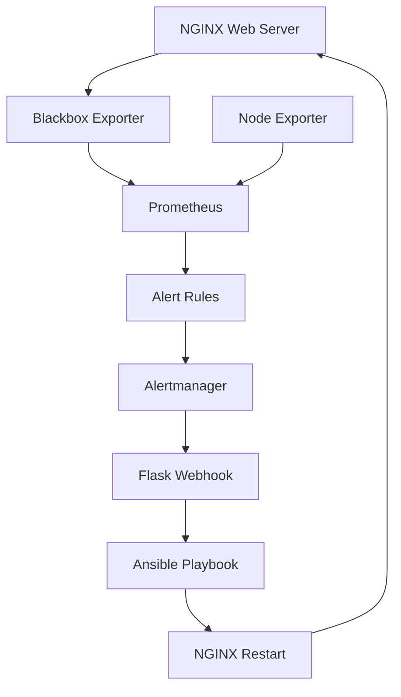

# Self-Healing Infrastructure Using Prometheus, Alertmanager and Ansible

## 1. Project Overview

This project implements a self-healing infrastructure monitoring and automated recovery system using Prometheus, Alertmanager, Blackbox Exporter, Node Exporter, Flask and Ansible.

The system continuously monitors an NGINX web server. When NGINX becomes unavailable, Prometheus detects the failure and generates an alert. Alertmanager forwards the alert to a Flask webhook, which triggers an Ansible playbook to restart the NGINX service automatically.

The objective is to reduce manual intervention, improve service availability and demonstrate infrastructure automation.

## 2. Project Objectives

- Monitor server health and resource utilization.
- Monitor NGINX HTTP availability.
- Detect service failures automatically.
- Generate alerts using Prometheus alert rules.
- Forward alerts through Alertmanager.
- Receive alerts through a Flask webhook.
- Execute Ansible automation for service recovery.
- Verify automatic recovery through end-to-end testing.

## 3. Architecture



### Workflow Explanation

1. NGINX runs as the web server.
2. Blackbox Exporter checks whether the NGINX HTTP endpoint is responding.
3. Node Exporter collects system metrics such as CPU usage.
4. Prometheus collects metrics every 15 seconds.
5. Prometheus evaluates configured alert rules.
6. Alertmanager receives and routes firing alerts.
7. Flask receives Alertmanager webhook notifications.
8. The Flask application checks the alert name.
9. If `NginxDown` is firing, Flask executes the Ansible playbook.
10. Ansible restarts NGINX.
11. Prometheus detects that the HTTP endpoint is responding again.

**Important:** The Flask webhook only triggers recovery for `NginxDown`. The `HighCPUUsage` alert is ignored by the recovery application.

## 4. Technologies Used

| Technology | Version / Purpose |
|---|---|
| Ubuntu | 26.04.1 LTS |
| NGINX | 1.28.3 |
| Prometheus | 3.9.1 |
| Alertmanager | 0.29.0 |
| Node Exporter | 1.10.2 |
| Blackbox Exporter | 0.27.0 |
| Ansible | 2.20.1 |
| Python | 3.14.4 |
| Flask | Webhook application |
| AWS EC2 | Cloud infrastructure |
| systemd | Service management |

## 5. Project Directory Structure

```text
self-healing-infrastructure/
│
├── README.md
├── .gitignore
├── requirements.txt
│
├── prometheus/
│   ├── prometheus.yml
│   └── alert_rules.yml
│
├── alertmanager/
│   └── alertmanager.yml
│
├── blackbox/
│   └── blackbox.yml
│
├── ansible/
│   ├── hosts
│   └── restart_nginx.yml
│
├── webhook/
│   └── app.py
│
├── systemd/
│   ├── prometheus.service
│   ├── alertmanager.service
│   ├── node_exporter.service
│   ├── blackbox_exporter.service
│   └── webhook.service
│
└── screenshots/
```

## 6. Monitoring Configuration

### Prometheus

Prometheus collects metrics from three monitoring targets:

- Prometheus: localhost:9090
- Node Exporter: localhost:9100
- Blackbox Exporter: localhost:9115

The scrape interval is configured to 15 seconds.

### Node Exporter

Node Exporter collects system-level metrics, including CPU, memory, disk and network statistics.

### Blackbox Exporter

Blackbox Exporter monitors NGINX using the `http_2xx` module.

A successful HTTP probe returns:

```text
probe_success 1
```

A failed HTTP probe returns:

```text
probe_success 0
```

## 7. Prometheus Alert Rules

Two alert rules are configured.

### NginxDown

```yaml
- alert: NginxDown
  expr: probe_success == 0
  for: 1m
  labels:
    severity: critical
  annotations:
    summary: "NGINX is down"
    description: "NGINX HTTP probe has failed for more than 1 minute."
```

This alert fires when the NGINX HTTP probe fails continuously for one minute.

### HighCPUUsage

```yaml
- alert: HighCPUUsage
  expr: 100 - (avg by(instance) (rate(node_cpu_seconds_total{mode="idle"}[5m])) * 100) > 90
  for: 2m
  labels:
    severity: warning
  annotations:
    summary: "High CPU usage detected"
    description: "CPU usage has exceeded 90% for more than 2 minutes."
```

This alert fires when CPU usage exceeds 90% for two minutes.

## 8. Alertmanager Integration

Alertmanager receives alerts from Prometheus and forwards notifications to the Flask webhook.

Webhook endpoint:

```text
http://127.0.0.1:5001/
```

The webhook listens only on the EC2 instance's loopback interface.

## 9. Flask Webhook

The Flask application receives Alertmanager POST requests.

Its responsibilities are:

- Receive alert notifications.
- Read the alert name and status.
- Ignore alerts other than a firing `NginxDown` alert.
- Execute the Ansible playbook when NGINX is down.
- Return the automation result.

## 10. Ansible Recovery Automation

The Ansible playbook is:

`ansible/restart_nginx.yml`

It targets the local EC2 instance through the Ansible inventory.

The playbook uses the Ansible service module to restart NGINX.

```yaml
---
- name: Restart NGINX when required
  hosts: webservers
  become: yes

  tasks:
    - name: Ensure NGINX is running
      ansible.builtin.service:
        name: nginx
        state: restarted
```

## 11. Deployment and Configuration

The following instructions describe the configuration layout used by the EC2 deployment.

### Prerequisites

- Ubuntu EC2 instance
- NGINX
- Prometheus
- Alertmanager
- Node Exporter
- Blackbox Exporter
- Ansible
- Python 3
- Flask

### Configuration locations

Copy the repository configurations to the following locations:

| Repository file | Deployment location |
|---|---|
| prometheus/prometheus.yml | /etc/prometheus/prometheus.yml |
| prometheus/alert_rules.yml | /etc/prometheus/rules/alert_rules.yml |
| alertmanager/alertmanager.yml | /etc/alertmanager/alertmanager.yml |
| blackbox/blackbox.yml | /etc/blackbox_exporter/blackbox.yml |
| ansible/hosts | /etc/ansible/hosts |
| ansible/restart_nginx.yml | /opt/self-healing/ansible/restart_nginx.yml |
| webhook/app.py | /opt/self-healing/webhook/app.py |

The systemd unit files are provided in the `systemd/` directory.

### Validate Prometheus configuration

```bash
sudo promtool check config /etc/prometheus/prometheus.yml
```

### Validate alert rules

```bash
sudo promtool check rules /etc/prometheus/rules/alert_rules.yml
```

### Validate Alertmanager configuration

```bash
sudo amtool check-config /etc/alertmanager/alertmanager.yml
```

### Validate Ansible connectivity

```bash
ansible webservers -m ping
```

### Start services

After installing the configurations and service units, reload systemd and enable the services:

```bash
sudo systemctl daemon-reload

sudo systemctl enable --now nginx
sudo systemctl enable --now prometheus
sudo systemctl enable --now alertmanager
sudo systemctl enable --now node_exporter
sudo systemctl enable --now blackbox_exporter
sudo systemctl enable --now webhook
```

Check individual service status using:

```bash
sudo systemctl status prometheus
sudo systemctl status alertmanager
sudo systemctl status node_exporter
sudo systemctl status blackbox_exporter
sudo systemctl status webhook
```

## 12. Testing and Validation

### Test 1: NGINX availability

```bash
curl http://localhost
```

Expected result: NGINX returns an HTTP response.

### Test 2: Blackbox monitoring

```bash
curl "http://localhost:9115/probe?target=http://localhost&module=http_2xx"
```

Expected result when NGINX is running:

```text
probe_success 1
```

### Test 3: Ansible connectivity

```bash
ansible webservers -m ping
```

Expected result:

```text
localhost | SUCCESS => {
    "ping": "pong"
}
```

### Test 4: Automatic recovery

Stop NGINX to simulate a service failure:

```bash
sudo systemctl stop nginx
```

Check the Blackbox probe:

```bash
curl "http://localhost:9115/probe?target=http://localhost&module=http_2xx"
```

Expected result:

```text
probe_success 0
```

Wait for the alert evaluation and notification process.

Prometheus detects the failure, Alertmanager forwards the alert, and Flask triggers Ansible.

Check NGINX status:

```bash
sudo systemctl status nginx
```

Expected result:

```text
Active: active (running)
```

The service should be restored automatically.

### Test 5: Webhook filtering

Send a simulated HighCPUUsage alert:

```bash
curl -X POST http://127.0.0.1:5001/ \
-H "Content-Type: application/json" \
-d '{"alerts":[{"status":"firing","labels":{"alertname":"HighCPUUsage"}}]}'
```

Expected response:

```json
{"status":"ignored"}
```

This verifies that unrelated alerts do not trigger NGINX recovery.

### Test 6: Direct recovery webhook test

```bash
curl -X POST http://127.0.0.1:5001/ \
-H "Content-Type: application/json" \
-d '{"alerts":[{"status":"firing","labels":{"alertname":"NginxDown"}}]}'
```

Expected response includes:

```json
{"status":"success"}
```

The Ansible output should report zero failed tasks.

## 13. Results

The project was successfully tested on an Ubuntu AWS EC2 instance.

Verified results:

- Prometheus successfully collected monitoring metrics.
- Blackbox Exporter detected NGINX availability.
- Prometheus generated the NGINX failure alert.
- Alertmanager received the firing alert.
- Flask received and processed the webhook notification.
- Ansible executed the NGINX recovery playbook.
- NGINX returned to the active state.
- HighCPUUsage notifications were ignored by the recovery webhook.

## 14. Security Considerations

- The Flask webhook binds to `127.0.0.1:5001`.
- The webhook port should not be exposed publicly.
- Use restricted AWS security group rules.
- Protect the Prometheus and Alertmanager dashboards from unauthorized access.
- The demonstration webhook runs as root to perform service recovery. A production deployment should use a dedicated restricted service account and narrowly scoped privileges.
- Add webhook authentication and appropriate request validation before production use.

## 15. Future Improvements

- Add Grafana dashboards for infrastructure visualization.
- Integrate email or messaging notifications.
- Add more recovery playbooks for other services.
- Introduce webhook authentication.
- Implement restricted privilege execution.
- Add Docker-based deployment.
- Integrate CI/CD automation.
- Add recovery logs and monitoring of automation failures.

## 16. Conclusion

This project demonstrates how monitoring, alerting and infrastructure automation can work together to create a self-healing system.

By combining Prometheus, Alertmanager, Flask and Ansible, the infrastructure can detect an NGINX failure and automatically recover the service without requiring manual intervention.

The project provides practical experience in cloud infrastructure monitoring, Linux service management, Python webhook development and configuration management automation.
